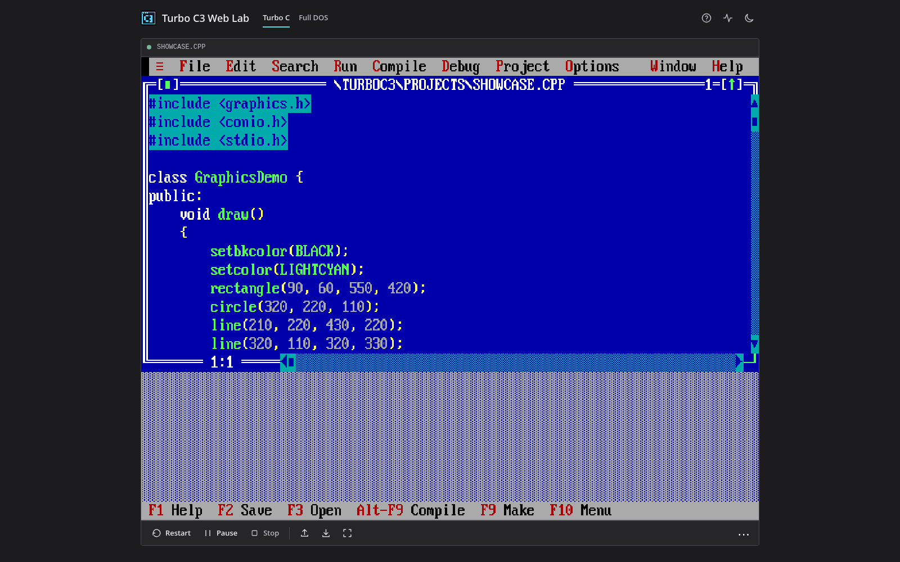

# Turbo C++ Online IDE

Run **Turbo C / Turbo C++ 3.0** in your browser with classic Borland **graphics.h / BGI** support. No installation, account, or build setup required.

**[Launch the online IDE](https://kmanisk.github.io/turbo-c-online-ide/)**



## Features

- **Turbo C++ IDE:** Edit, compile, and run legacy C/C++ programs, including the built-in `SHOWCASE.CPP` graphics demo.
- **Full DOS mode:** Use a DOS prompt, run your own DOS software, manage files, and mount floppy/CD images.
- **graphics.h / BGI:** Includes Borland graphics libraries and drivers for classic computer-graphics programs.
- **Local workspace:** Import C/C++ files and ZIP archives, save in your browser, and export files or a ZIP backup.
- **Usable interface:** Fullscreen, 4:3/fit scaling, themes, keyboard shortcut help, and mouse recovery.
- **Lightweight:** Static HTML/CSS/JavaScript powered by js-dos and WebAssembly.

## Getting started

1. Choose **Turbo C** or **Full DOS**, then press **Start**.
2. For graphics, open the bundled `SHOWCASE.CPP` program, or select **BGI Graphics** from the sample menu.
3. In Turbo C, use **F2** to save, **Alt+F9** to compile, **Ctrl+F9** to run, and **Alt+F5** to view program output.
4. Open **Download** (down-arrow icon) to save files in this browser or export a ZIP backup. Use **More** (three dots) for scaling and mouse controls.

A physical keyboard is recommended. Files saved in browser storage do not automatically sync between devices.

## Run locally

Serve this static repository over HTTP and open `http://localhost:8080`:

```bash
python3 -m http.server 8080
```

The graphics test page is available at `?bgi-test=1`.

> **Note:** This is a legacy Turbo C++/DOS compatibility environment, not a modern C++ toolchain. Turbo C++ and DOS components are third-party software with separate redistribution/licensing considerations.
